# Manual de usuario para Sistema de Registro de Horas ProDUS

Última actualización: 22 de octubre de 2026.

## Inicio de sesión

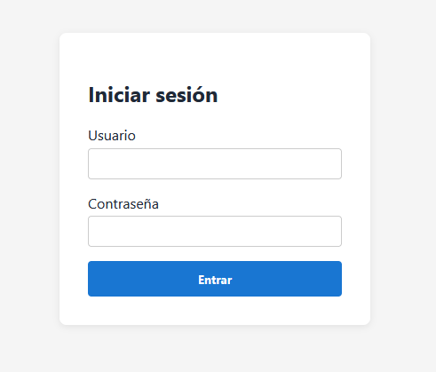

Primero, se debe iniciar sesión con el **usuario** y **contraseña** provistos por un administrador.

Ejemplo:

Usuario: *Elliott Smith*

Contraseña: *@ngel3S?*

*La contraseña debe tener mínimo 8 caracteres, una mayúscula y un número*

# Vista de asistente

## Vista principal

### Registro de horas

### Mis horarios

### Mis reportes

### Solicitudes de cambio

# Vista de administrador

## Vista principal

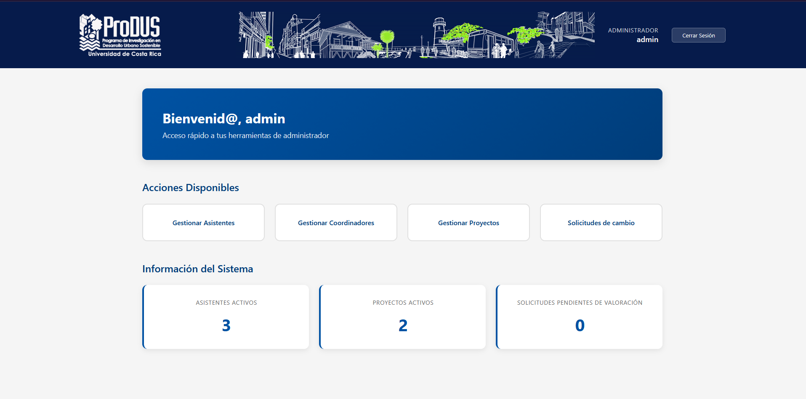

## Gestionar Asistentes

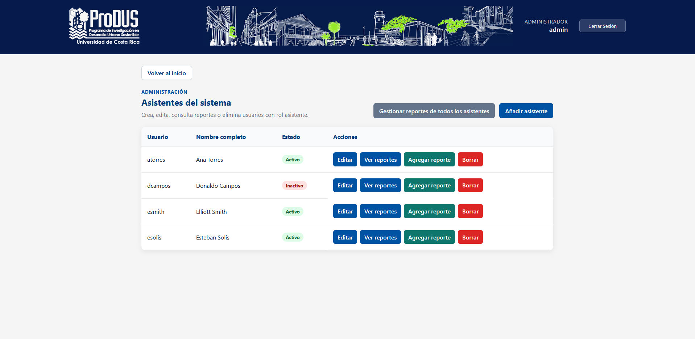

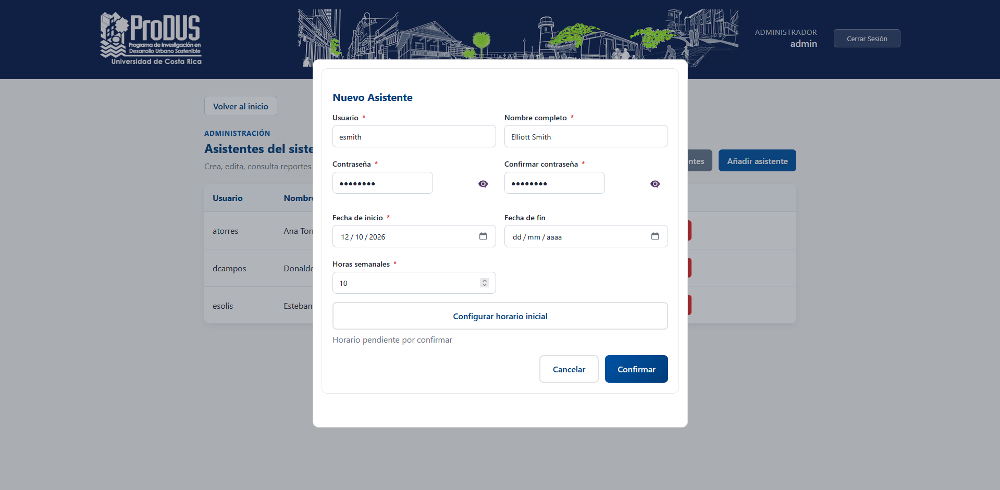

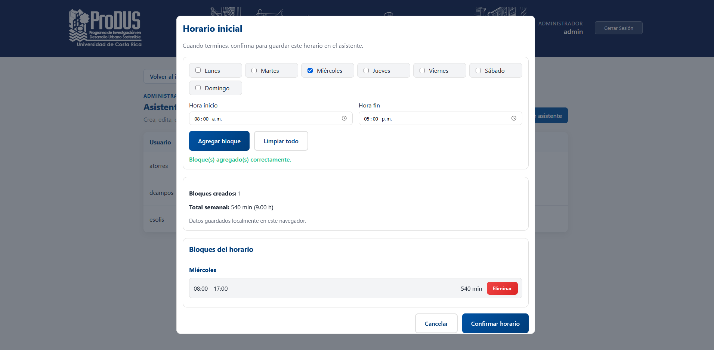

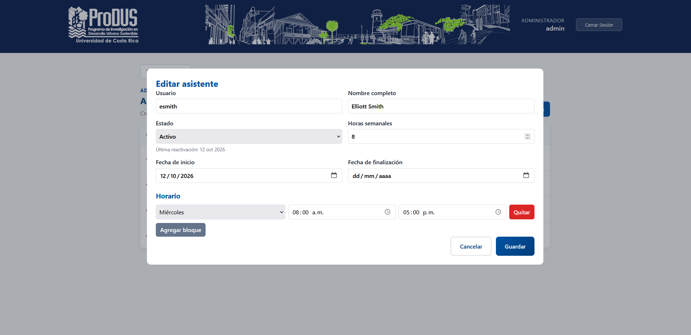

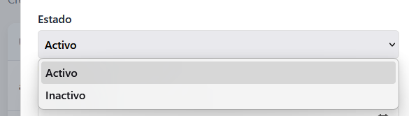

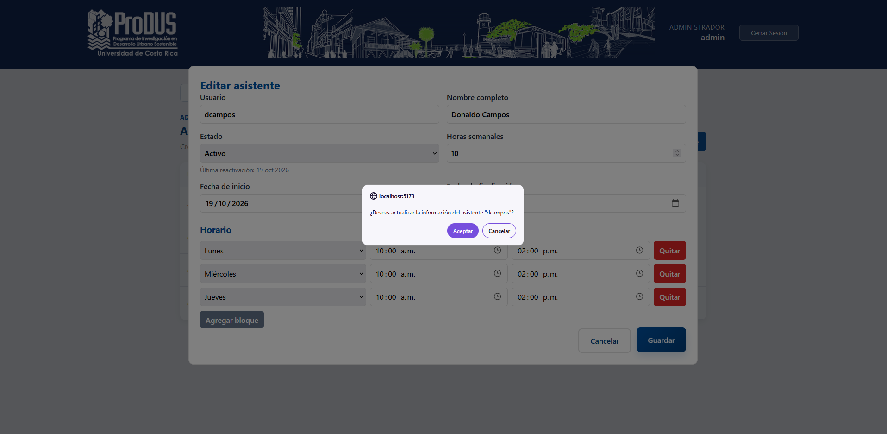

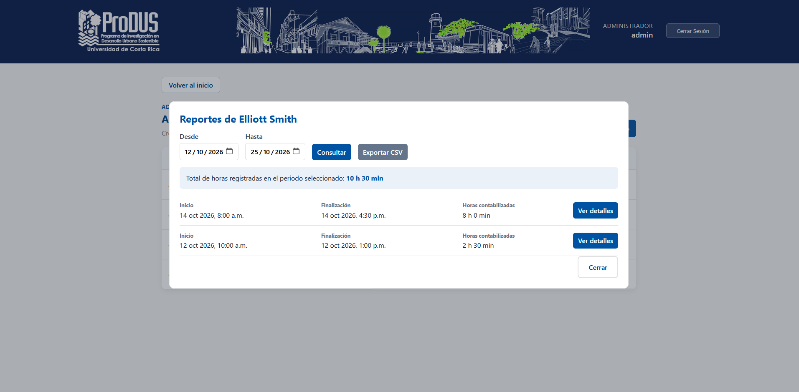

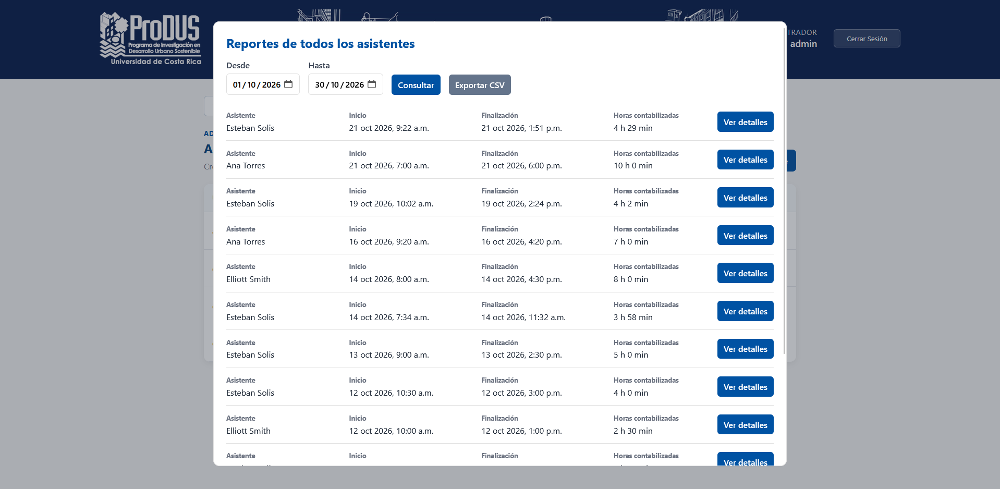

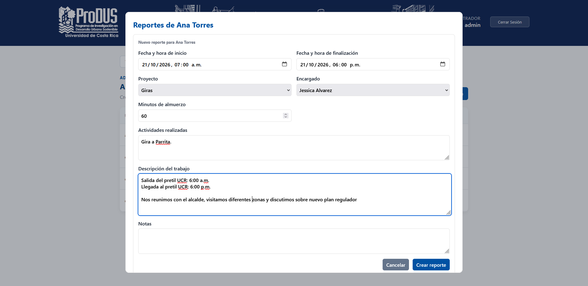

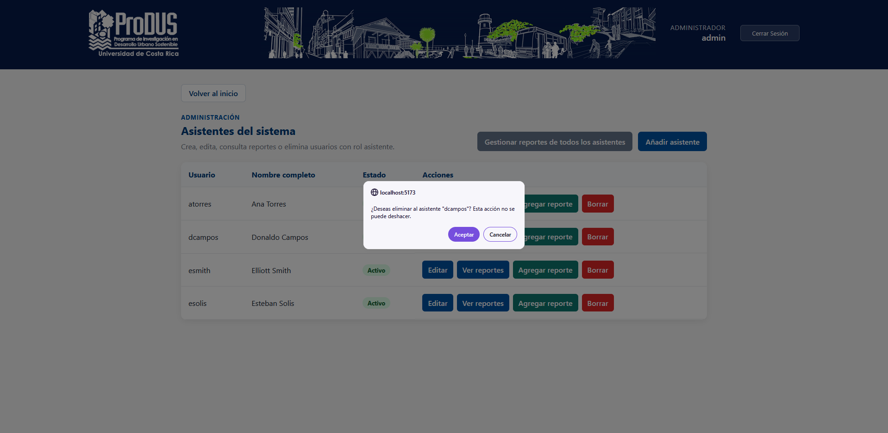

## Gestionar Coordinadores

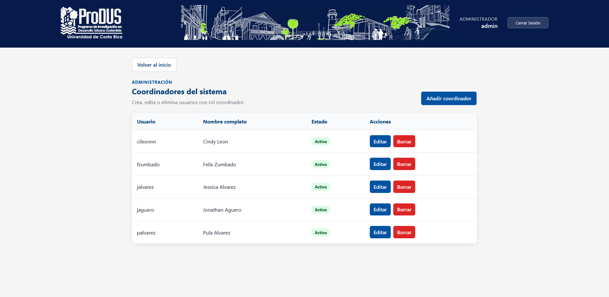

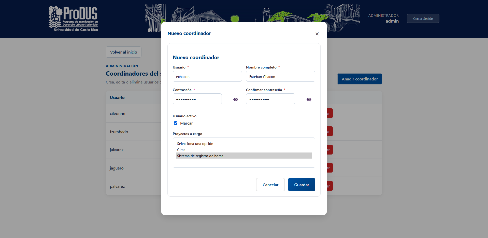

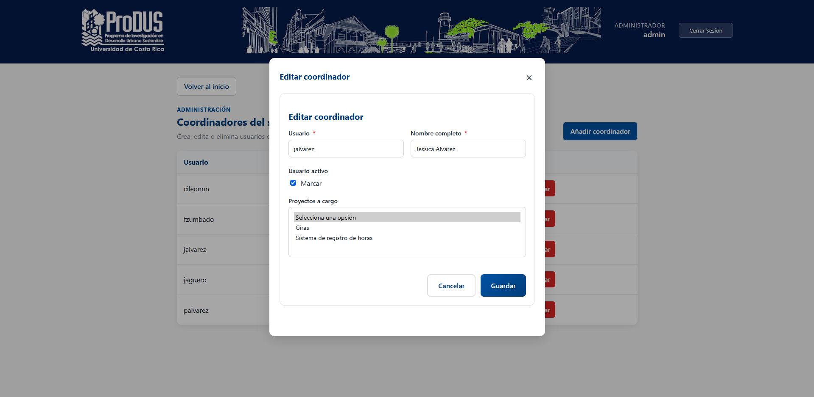

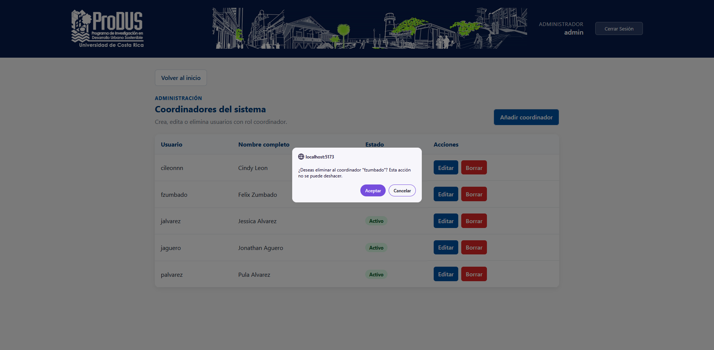

## Gestionar Proyectos

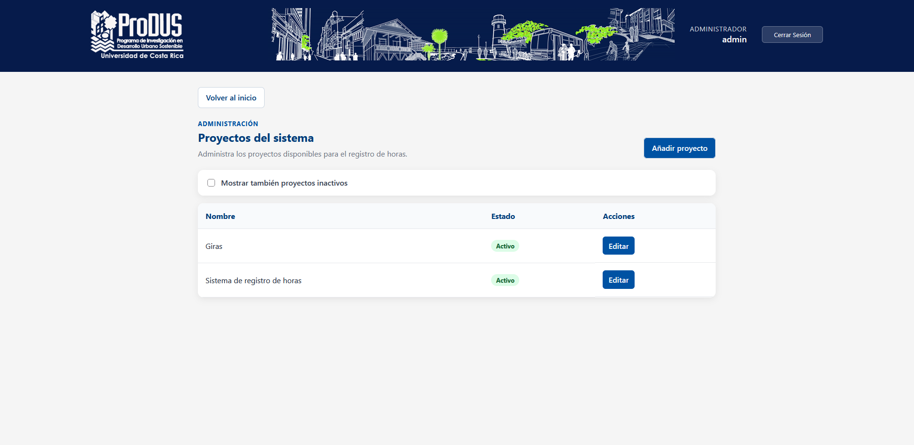

## Solicitudes de cambio